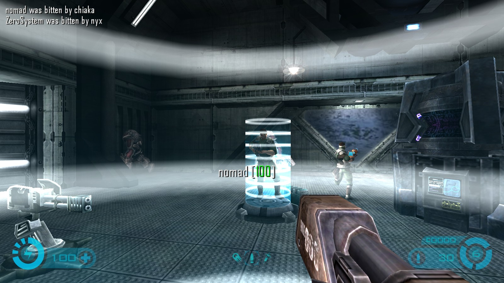
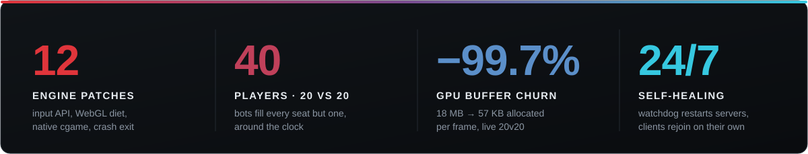
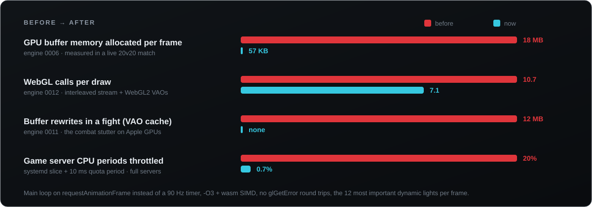
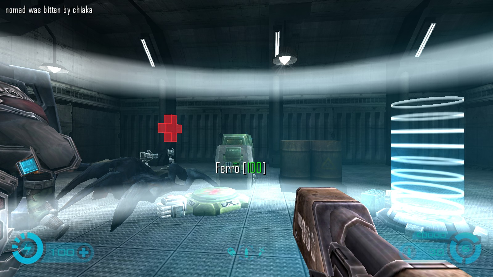
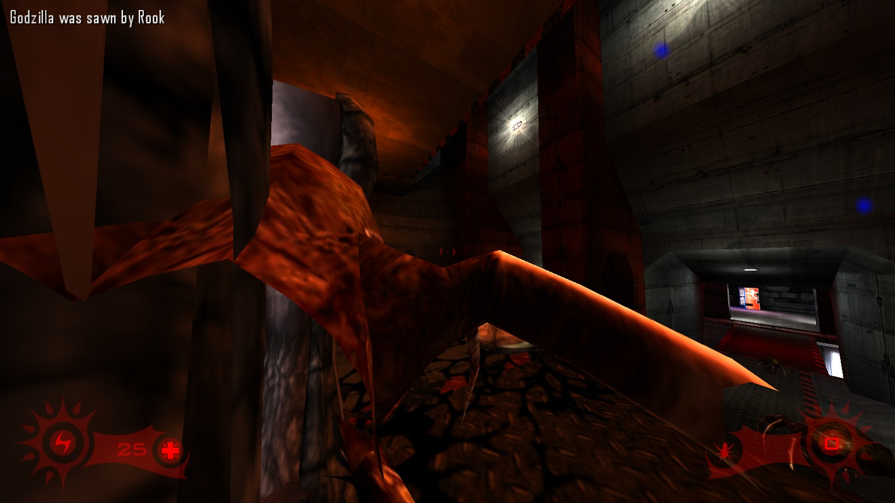
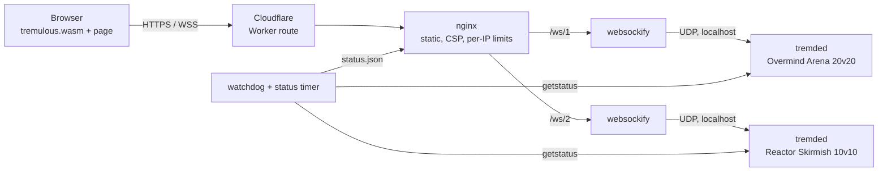

<p align="center">
  <a href="https://webnova360.com/play-tremulous/"></a>
</p>

<h3 align="center">Overmind — the browser edition, rebuilt</h3>

<p align="center">
  The 2006 aliens-vs-humans classic in a browser tab: PC, tablet and phone,<br>
  full 20v20 servers, no download, no account.
</p>

<p align="center">
  <a href="https://webnova360.com/play-tremulous/"></a>
</p>

<p align="center">
  
  
  
  
</p>

<p align="center">
  
</p>
<p align="center"><sub>Live 20v20 server, captured from the browser client. Everything on screen except you is a bot.</sub></p>

---

**This is not a mirror.** The browser port by [justinl1996](https://github.com/justinl1996/tremulous) proved Tremulous can run in a tab. We took it from *runs* to *plays*. The changes:

- **12 engine patches**, from a touch input API to a WebGL call diet to a native cgame.
- **A rewritten bot game module** that keeps two servers full around the clock.
- **A touch-first web client** with about 2,500 lines of hand-written controls, settings and loader.
- **A hosting stack** that heals itself when something crashes.

Every change ships as a plain patch file on top of a pinned upstream commit, so each one can be reviewed on its own.

<p align="center">
  
</p>

## Contents

[Performance](#performance) · [Bots](#bots-that-play-like-a-team) · [Controls](#controls-touch-and-pc) · [Self-healing ops](#self-healing-servers) · [Architecture](#architecture) · [Build](#build-and-deploy) · [Credits](#credits)

---

## Performance

A shooter that runs at 150 fps but *feels* like 20 is broken. We measured frame time and GL calls on real hardware with a full 20v20 server and fixed what we found. One target mattered most: Chrome on Apple Silicon, where every WebGL call crosses into the GPU process and goes through ANGLE to Metal.

<p align="center">
  
</p>

| Patch | What changed | Why it matters |
|---|---|---|
| [`0005`](patches/engine/0005-max-performance.patch) | `-O3`, WebAssembly SIMD, no `glGetError()` when errors are ignored | each `glGetError` was a synchronous GPU round trip, many times per frame |
| [`0006`](patches/engine/0006-webgl-stream-tess-vertices.patch) | Exact-size vertex uploads instead of orphaning full buffers | about 45 fresh 300 KB buffers a frame dropped to one tight upload: **18 MB → 57 KB** |
| [`0008`](patches/engine/0008-native-cgame.patch) | Client game module compiled into the wasm | the HUD, prediction and effects run as native wasm instead of in the QVM interpreter |
| [`0009`](patches/engine/0009-raf-loop-and-dlight-cap.patch) | Main loop on `requestAnimationFrame`, keep the 12 most important dynamic lights | frames line up with the display; a firefight no longer multiplies light passes |
| [`0011`](patches/engine/0011-webgl-no-vao-cache.patch) | Skip the renderer's 12 MB VAO cache on WebGL | rewriting a buffer the GPU still uses stalls Metal; this was **the combat stutter** |
| [`0012`](patches/engine/0012-webgl-interleaved-tess-stream.patch) | Interleaved vertex stream, attribute pointers only on layout change, real WebGL2 VAOs | **a third fewer GL calls**: 10.7 → 7.1 per draw |

Nothing was turned down to get there: same textures, same shaders, same resolution. [`web/perf.js`](web/perf.js) sends anonymous frame-time reports (fps, slow frames, draw and upload counts, GPU string, no IP logged), so regressions on devices we don't own show up.

## Bots that play like a team

Base: [lepe/trem-gpp-bots](https://github.com/lepe/trem-gpp-bots). Our patch is [`patches/bots/0001-overmind-bots.patch`](patches/bots/0001-overmind-bots.patch): about 680 lines added across 16 files.

<table>
<tr>
<td width="50%"></td>
<td width="50%"></td>
</tr>
</table>

- **Always one seat free.** `g_bot_fillTeam N` fills both teams to N vs N but never past 2N−1. When a real player picks a side, a bot on that side leaves for them.
- **Bots build bases.** P-Bot fought, evolved and bought, but never built. Our bot builders rebuild a lost core first, then place structures through the same `G_CanBuild()` check a player uses. Alien bots stay on creep and don't build through walls.
- **Skill 1–10 per map.** Each map rolls a base skill, and every bot gets ±2 around it. Skill scales aim error, and bots turn with human-like speed.
- **A believable lobby.** Bots have real-looking names and per-bot pings with jitter.
- **The armoury works like the 1.3 menus.** Buying a weapon or upgrade sells whatever blocks its slot and credits you for it. You no longer see "no room to carry this".
- **Crash fixes from real matches.** The bot path history overflowed into the allocator, and map changes freed a path array sized by a pointer.

## Controls: touch and PC

**Touch** ([`web/touch.js`](web/touch.js), about 800 lines, loaded only on touch-first devices):

- **Moving and aiming**
  - A floating move stick that appears under your thumb. Push to the rim to sprint.
  - Drag-to-look that is 1:1 for normal drags and accelerates only on flicks, with mild aim friction while the crosshair is on an enemy.
  - Optional gyro aiming with a deadzone, including the iOS permission flow.
- **Buttons**
  - Auto fire, driven by a cgame flag that knows when the crosshair rests on an enemy in range of the held weapon.
  - A second fire button for the left thumb.
  - Every button in the right thumb cluster is "soft": a thumb that lands on it to aim just aims, and only a clean tap triggers it.
  - Buttons change per class: each alien gets its own attacks and wallwalk, humans get medkit, jetpack, grenade and build.
- **Menus**
  - Large team, class and build pickers.
  - Chat through the device keyboard, a vote bar, and haptics.
  - Button size and brightness settings.

**PC** ([`web/settings.js`](web/settings.js), F10 or Escape → Options):

- Rebindable keys that apply live, plus sensitivity, inverted look and raw mouse input.
- In-game brightness for the darker maps. The engine's gamma needs hardware gamma ramps, which a browser can't provide, so we brighten the finished picture instead.
- Fullscreen with Keyboard Lock, so Escape opens the game menu instead of leaving fullscreen.

## Self-healing servers

Nobody should have to SSH in at 3 a.m.

| Layer | What happens |
|---|---|
| **Engine** [`0010`](patches/engine/0010-dedicated-exit-on-drop.patch) | The dedicated server exits on an error that would have left it idle on no map. systemd restarts it. |
| **Watchdog** [`deploy/status/tremulous-watchdog.py`](deploy/status/tremulous-watchdog.py) | It queries each server every 10 s. After three failed or mapless answers it restarts the server, so even a hung process comes back. |
| **Client** [`web/play.js`](web/play.js) | If the connection drops mid-game, the page rejoins on its own once the server is back. |
| **systemd** [`deploy/systemd`](deploy/systemd) | Game servers run in their own top-level slice with high CPU weight and a 10 ms quota period, so a busy shared host can't starve a 40-player match. |

Security comes with it:

- Units run unprivileged with `ProtectSystem=strict`, a syscall filter and localhost-only networking.
- nginx sends a strict CSP (no inline scripts) and enforces per-IP limits.
- Engine patch [`0007`](patches/engine/0007-gateway-connection-isolation.patch) makes sure nobody behind the WebSocket gateway can take over another player's slot by guessing a qport.

## Architecture



Browsers can't send UDP, so each server sits behind a [websockify](https://github.com/justinl1996/websockify) gateway that bridges WebSocket and UDP. Only nginx is reachable from outside.

<details>
<summary><b>All engine patches</b> (applied to <a href="https://github.com/justinl1996/tremulous">justinl1996/tremulous</a> at a pinned commit)</summary>

| # | Patch | |
|---|---|---|
| 0001 | Menu cursor follows the mouse | menus feed exact deltas in 640×480 UI space, so items can be hit |
| 0002 | Release build without assertions | `-s ASSERTIONS=0` |
| 0003 | Browser input API, smaller memory | `Overmind_Action/Look/Pointer/State/Resize/Command` exports; 768 → 320 MB initial memory |
| 0004 | `-O2` instead of `-O1` | the old `-O1` workaround made the QVM interpreter much slower |
| 0005 | Maximum performance, no visual change | `-O3`, SIMD, `GL_TRACK_ERRORS=0`, skip `glGetError` |
| 0006 | Stream tess vertices exactly | 18 MB → 57 KB buffer allocations per frame |
| 0007 | Gateway connection isolation | no slot takeover behind the WebSocket gateway |
| 0008 | Native cgame | the client game module linked into the wasm |
| 0009 | rAF loop, dynamic light cap | `requestAnimationFrame`; `r_maxDlights` (default 12) |
| 0010 | Dedicated exit on drop | crashes end in a restart instead of an idle server |
| 0011 | No VAO cache on WebGL | removes the busy-buffer rewrites behind combat stutter |
| 0012 | Interleaved tess stream, WebGL2 VAOs | 10.7 → 7.1 GL calls per draw |

</details>

<details>
<summary><b>Repository layout</b></summary>

| Path | Contents |
|---|---|
| [`patches/engine/`](patches/engine) | Engine patches 0001–0012 |
| [`patches/bots/`](patches/bots) | Game and cgame patch for trem-gpp-bots |
| [`web/`](web) | Landing page, `play.js`, `touch.js`, `settings.js`, `perf.js`, service worker, manifest |
| [`branding/pk3/`](branding/pk3) | In-game menus with server switching, packed into `zz-webnova360.pk3` |
| [`scripts/`](scripts) | `build-web.js` (content-hashed release), `dev-server.js`, host scripts in `remote/` |
| [`deploy/`](deploy) | nginx, Cloudflare Worker, systemd units and slice, server configs, status probe, watchdog |

</details>

## Build and deploy

You need Node 18+ and the game data from the web stack:

```bash
git clone https://github.com/justinl1996/tremulous_web src/tremulous_web
git -C src/tremulous_web lfs pull
node scripts/build-web.js --client path/to/web-client   # omit --client to use the upstream prebuilt engine
node scripts/dev-server.js 8080 build/web
```

Then open `http://localhost:8080/?play=menu`. The dev server tunnels game websockets to the live servers, so you can try a local client build in real matches.

<details>
<summary><b>Engine, game module and host scripts</b></summary>

**Engine and game module.** Each build does the following:
1. Clones the engine at the pinned commit and applies `patches/engine/*.patch` in order.
2. Builds the client with Emscripten 3.1.74 (`emmake make release PLATFORM=js BUILD_CLIENT=1`).
3. Builds the dedicated server and the bot QVMs from lepe/trem-gpp-bots with `patches/bots/*.patch`.

**Host scripts** live in `scripts/remote/` and run through `scripts/remote.ps1`:
1. `01-bootstrap.sh`: one-time setup (packages, an unprivileged service user, sources).
2. `03-build-on-host.sh`: builds `tremded` and the bot `game.qvm` and `cgame.qvm`.
3. `04b-build-client-staging.sh`: builds the wasm client into a staging folder, in a capped systemd scope.
4. `05-promote-client.sh`: promotes the tested client and keeps the previous one for rollback.
5. `02-deploy.sh <host> [ref] [nightly|local] [webonly]`: idempotent deploy. Installs nginx, the units, the slice and the watchdog, then checks health through `status.json`. `webonly` leaves running matches alone.

Host connection details live in a local, git-ignored file.

</details>

## Credits

Tremulous exists because of a lot of people:

- **Dark Legion Development** created the game.
- **GrangerHub** kept it alive with 1.3.
- **Justin Luong (greekman99)** and **Auriga** did the Emscripten port, [tremulous_web](https://github.com/justinl1996/tremulous_web) and the UDP-capable websockify. Their work builds on **QuakeJS** and **ioquake3**.
- The bots come from **P-Bot**, **GlobalWarming / lepe** ([trem-gpp-bots](https://github.com/lepe/trem-gpp-bots)) and **CoW-Tremulous**.

The full list is in [CREDITS.md](CREDITS.md).

The browser edition is built and hosted by **[WebNova360](https://webnova360.com/?ref=github)**. We build software and automation for EU teams.

## License

- **Code** is GPL. The engine is GPL-2.0-or-later; the web stack and our additions are GPL-3.0 ([LICENSE](LICENSE)).
- **Game data** is [CC BY-SA 2.5](https://creativecommons.org/licenses/by-sa/2.5/). The branding pak and the artwork derived from it keep that license.

Found a security problem? See [SECURITY.md](SECURITY.md).

<p align="center"><br><a href="https://webnova360.com/play-tremulous/"><b>Play now →</b></a></p>
