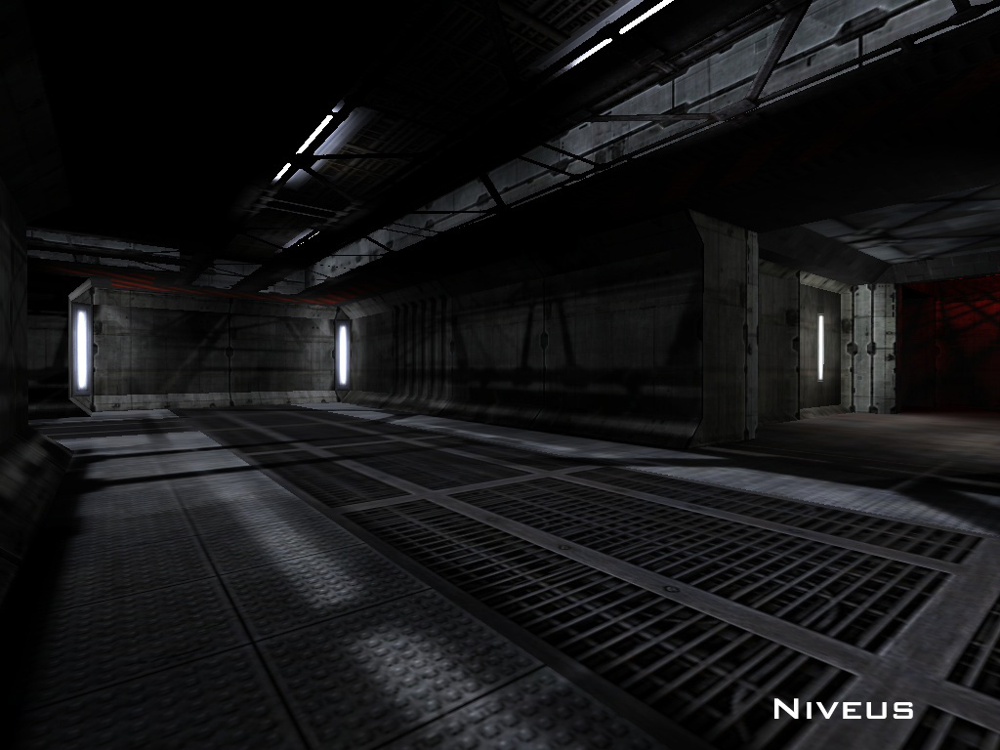
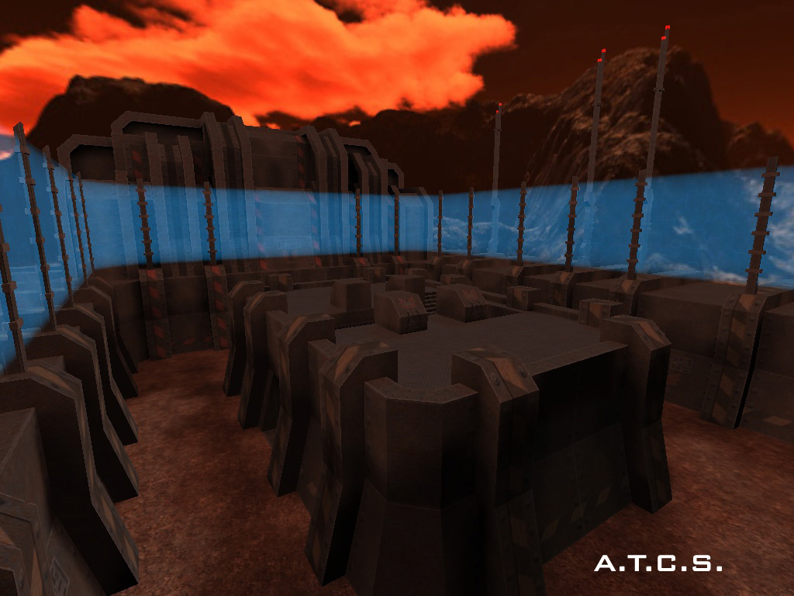
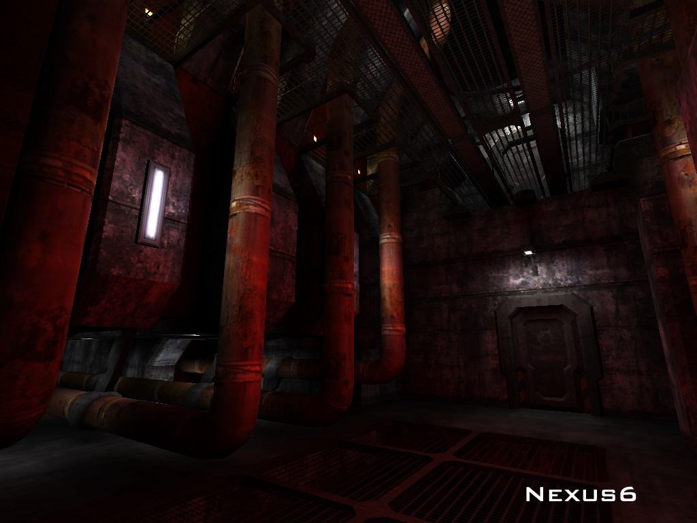
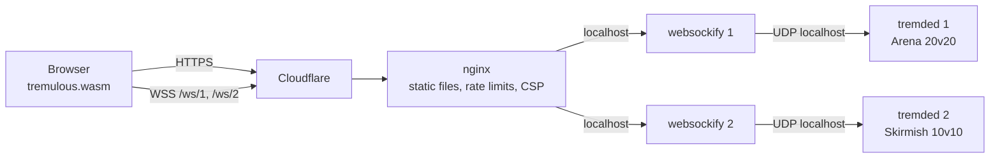

<p align="center">
  
</p>

<h3 align="center">Tremulous Overmind</h3>
<p align="center">
  The 2006 aliens-vs-humans shooter, running in a browser tab.<br>
  Presented by <a href="https://webnova360.com/?ref=github"><b>WebNova360.com</b></a>
</p>

<p align="center">
  <a href="https://github.com/fiveworld-development/tremulous-overmind/actions/workflows/build.yml"></a>
  
  
</p>

---

Tremulous is a team game: one side grows an alien hive around the **Overmind**, the other holds a human base powered by a **Reactor**. Aliens evolve from a tiny dretch into a tyrant; humans buy their way up from a rifle to lucifer cannons and battlesuits. You win by killing the other team's spawns.

This repository is the browser edition we host: the engine compiled to WebAssembly, served as a plain static site, and two dedicated servers that are kept full with bots when there aren't enough people around.

<p align="center">
  
  
  
</p>

## What's in here

| | |
|---|---|
| **Engine** | [justinl1996/tremulous](https://github.com/justinl1996/tremulous) (Tremulous 1.3 / GrangerHub line, Emscripten build), pinned, plus our patches in [`patches/engine`](patches/engine) |
| **Bots** | [lepe/trem-gpp-bots](https://github.com/lepe/trem-gpp-bots) game module with waypoints for 9 maps, plus [`patches/bots`](patches/bots) (`g_bot_fillTeam`: bots fill each team to a target size and step aside for real players) |
| **Web** | [`web/`](web) – landing page that doubles as the launcher; [`scripts/build-web.js`](scripts/build-web.js) turns it into a static release with content-addressed game data |
| **Servers** | [`deploy/`](deploy) – server configs, hardened systemd units, nginx site, status probe |
| **Branding** | [`branding/pk3`](branding/pk3) – in-game main menu with the WebNova360 credit line, packed into `zz-webnova360.pk3` |

### Patches so far

- **Menu cursor follows the mouse.** In the browser the engine kept the GPP menus in relative-mouse mode, so the drawn cursor drifted away from the real one and menu items could not be hit. Menus now pin the in-game cursor to the window cursor. ([0001](patches/engine/0001-menu-cursor-follows-mouse.patch))
- **Release build without Emscripten assertions.** ([0002](patches/engine/0002-release-build-no-assertions.patch))
- **Bots fill teams to a target size.** ([bots/0001](patches/bots/0001-fill-teams-with-bots.patch))

### On the list

- On-screen touch controls for phones and tablets
- Bot skill levels 1–10, randomised per map (ported from [CoW-Tremulous](https://github.com/cmf028/CoW-Tremulous))
- Smaller memory footprint and a faster optimisation level for the WASM build
- Waypoints for the four maps that don't have any yet

## How it fits together



Browsers can't send UDP, so each server sits behind a small WebSocket-to-UDP gateway. Nothing but nginx is reachable from outside.

## Security

The public surface is one nginx vhost that only answers `GET`/`HEAD`:

- the host firewall admits ports 80/443 from Cloudflare only; the game servers and gateways bind to `127.0.0.1` and their systemd units additionally deny every non-local address (`IPAddressDeny=any`)
- everything runs as an unprivileged `trem` user with `ProtectSystem=strict`, no capabilities, a syscall filter, and memory/CPU caps so the game can never starve other services on the host
- strict Content-Security-Policy (`script-src 'self' 'wasm-unsafe-eval'`, no inline scripts), HSTS, `frame-ancestors 'none'`, per-IP rate and connection limits on pages and websockets
- no remote console: `rconPassword` is empty, admin happens over SSH
- game data is content-addressed (`<crc32>-<name>.pk3`) and served immutable; the pure servers reject clients with modified paks
- builds are reproducible from pinned upstream commits in GitHub Actions; the host only downloads release artifacts and verifies their SHA-256

Found a problem? See [SECURITY.md](SECURITY.md).

## Build it yourself

Everything compiles in CI ([`.github/workflows/build.yml`](.github/workflows/build.yml)): the WASM client with Emscripten, the Linux dedicated server, and the bot game module. Each push to `main` updates the [`nightly` release](https://github.com/fiveworld-development/tremulous-overmind/releases/tag/nightly).

To assemble and serve the site locally you need Node 18+ and a checkout of the game data:

```bash
git clone https://github.com/justinl1996/tremulous_web src/tremulous_web
git -C src/tremulous_web lfs pull
node scripts/build-web.js --client path/to/web-client   # or omit --client to use the upstream prebuilt engine
node scripts/dev-server.js 8080 build/web
```

Then open `http://localhost:8080/?play=menu`.

## Credits

Tremulous was created by **Dark Legion Development** and kept alive by **GrangerHub**. The browser port is the work of **Justin Luong (greekman99)** and **Auriga (Alexander)**, building on **QuakeJS** and **ioquake3**. The bots come from **P-Bot**, **GlobalWarming / lepe** and **CoW-Tremulous**. Full list in [CREDITS.md](CREDITS.md).

Hosted and extended by [WebNova360](https://webnova360.com/?ref=github) – we build software and automation for EU teams.

## License

Code is GPL (engine GPL-2.0-or-later, web stack and our additions GPL-3.0, see [LICENSE](LICENSE)). Tremulous game data is [CC BY-SA 2.5](https://creativecommons.org/licenses/by-sa/2.5/). Our branding pak and landing page artwork reuse that data and stay under the same license.
