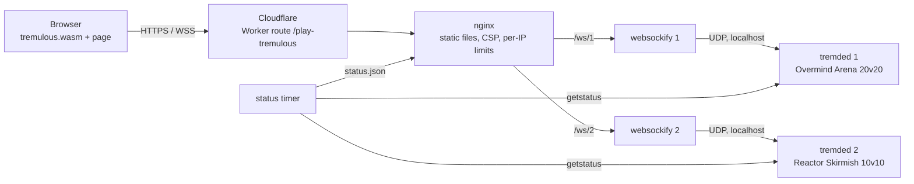

<p align="center">
  
</p>

<h3 align="center">Tremulous Overmind</h3>
<p align="center">
  The 2006 aliens-vs-humans shooter, running in a browser tab on PC, tablet and phone.<br>
  <a href="https://webnova360.com/play-tremulous/"><b>Play now</b></a> · Presented by <a href="https://webnova360.com/?ref=github"><b>WebNova360.com</b></a>
</p>

<p align="center">
  
  
</p>

---

Tremulous is a team game: one side grows an alien hive around the **Overmind**, the other holds a human base powered by a **Reactor**. Aliens evolve from a dretch into a tyrant; humans buy their way up from a rifle to lucifer cannons and battlesuits. You win by destroying the other team's spawns.

This repository is the browser edition we run at **[webnova360.com/play-tremulous](https://webnova360.com/play-tremulous/)**. It starts from two existing projects — the Emscripten port of Tremulous 1.3 by [justinl1996/tremulous](https://github.com/justinl1996/tremulous) and the bot game module [lepe/trem-gpp-bots](https://github.com/lepe/trem-gpp-bots) — and adds a faster WebAssembly client, a full touch control scheme, PC control settings, an installable web app, bots that keep two public servers populated around the clock, and the hosting stack that serves all of it.

<p align="center">
  
  
  
</p>

## At a glance

| Area | Upstream | What this repository adds |
|---|---|---|
| Engine (WASM client) | justinl1996/tremulous, pinned commit | 6 patches: performance, browser input API, menu cursor, memory |
| Game logic / bots | lepe/trem-gpp-bots (P-Bot, GPP) | 1 patch (~450 added lines): always-full servers, bot base building, skill levels, touch hooks in cgame, HUD fix |
| Web client | — | Landing page and launcher, ~690 lines of touch controls, ~520 lines of PC settings, PWA, service worker |
| Infrastructure | — | nginx site, Cloudflare Worker route, hardened systemd units, status probe, host build and deploy scripts |

Everything upstream is applied as plain patch files on top of pinned sources, so each change is reviewable on its own.

## What we changed

### Engine (WebAssembly client)

Base: [justinl1996/tremulous](https://github.com/justinl1996/tremulous) at a pinned commit, built with Emscripten 3.1.74. Patches in [`patches/engine`](patches/engine), applied in order:

- **0001 – Menu cursor follows the mouse.** The engine kept the 1.1/GPP menus in relative-mouse mode in the browser, so the drawn cursor drifted away from the real one and menu items could not be hit. Menus now pin the in-game cursor to the window cursor by feeding exact deltas in 640x480 UI space.
- **0002 – Release build without Emscripten assertions** (`-s ASSERTIONS=0`).
- **0003 – Browser input API and smaller memory footprint.**
  - Exports `Overmind_Action`, `Overmind_Look`, `Overmind_Pointer`, `Overmind_State`, `Overmind_Resize` and `Overmind_Command`. The page's touch layer queues key, look and menu-pointer events straight into the engine, with no synthetic DOM events and no pointer lock required.
  - `Overmind_Resize` changes the render size after rotation or resize and waits until the size settles before restarting video.
  - Initial memory goes from 768 MB to 320 MB and the stack from 256 MB to 64 MB, with memory growth still enabled.
  - Declares `ERRNO_CODES` so the system libraries link with current Emscripten.
- **0004 – `-O2` instead of `-O1`.** Upstream used `-O1` as a workaround for a signature-mismatch issue; that workaround made the QVM interpreter much slower.
- **0005 – Maximum performance without visual change.**
  - `-O3` and WebAssembly SIMD (`-msimd128`).
  - `GL_TRACK_ERRORS=0`.
  - Both renderers check `r_ignoreGLErrors` *before* calling `glGetError()`, which is a synchronous round trip to the GPU process in WebGL and ran many times per frame.
- **0006 – Stream tess vertices with exact-size uploads.** The stock GL2 renderer orphaned the full `SHADER_MAX_VERTEXES`-sized vertex and index buffers (`bufferData(NULL)`) twice per batch. In WebGL each of those calls allocates a fresh, zero-filled buffer of about 300 KB, at roughly 45 batches a frame, and on ANGLE/Metal a sub-upload into a buffer still in use copies the whole buffer. The patch packs only the used attributes into one stream and uploads exactly that with a single `bufferData` per buffer. Measured in a live 20v20 match (WebGL call counters in the browser): buffer memory allocated per frame went from about 18 MB to about 57 KB.

### Game logic and bots

Base: [lepe/trem-gpp-bots](https://github.com/lepe/trem-gpp-bots) (game and cgame QVM). One patch: [`patches/bots/0001-overmind-bots.patch`](patches/bots/0001-overmind-bots.patch).

- **Always-full servers.** `g_bot_fillTeam N` makes a server look like an N vs N match with exactly one open seat. Teams are topped up with bots, but bots plus real players never exceed 2N-1, so the next player always finds a seat, and a bot leaves as soon as that player joins a team.
- **Bot removal fix.** Bots live in the private slots at the bottom of the client range, so a connecting player is never given a bot's slot. Removal now searches every slot instead of the top range the original code assumed.
- **Team balance on real players only.** Anyone can pick the side they want, and a bot on that team gives up its seat.
- **Bots build bases.** The P-Bot AI fought, evolved and bought, but never built. Bot builders now rebuild a lost core first, then place structures near the base. Each placement goes through the same `G_CanBuild()` check as a real player standing there, aliens stay within creep range, and nothing is built through walls (`g_bot_build`).
- **Skill 1–10.** `g_bot_skill 0` rolls a base skill per map and spreads each bot ±2 around it. Skill scales aim error.
- **Believable lobby.** Bots get a new name list and a per-bot ping with jitter.
- **Touch support in cgame.**
  - The `overmind_state` cvar exports team, class, movement type and stages for the page's team and spawn pickers.
  - With `overmind_touch` set, the small engine team and class menus are skipped.
  - `overmind_aim` is set while the crosshair rests on a living enemy in reach of the held weapon. This drives auto fire. Builders, charge weapons and lob weapons never auto-fire.
- **HUD ownerdraw fix.** The ownerdraw enum is back in step with the 1.3 HUD files. This fixes a grey box in the middle of the screen and the misplaced console and tutorial text.

The patched `cgame.qvm` is shipped to clients as `zz-overmind-vm.pk3`, because the bot game module needs its matching client module.

### Web client

Source: [`web/`](web), assembled by [`scripts/build-web.js`](scripts/build-web.js).

**Touch controls** ([`web/touch.js`](web/touch.js), loaded only on touch-first devices):

Movement and aiming:
- A floating move stick that appears under the thumb. Push it to the rim to sprint, or double-tap and hold.
- Drag-to-look that is linear for normal drags and accelerates fast flicks, with calmer vertical speed, per-frame smoothing (touch events and frames tick at different rates) and aim friction while the crosshair is on an enemy. The thumb can keep aiming from any button in the right cluster.
- Optional gyro aiming with a deadzone and smoothing, including the iOS permission flow.

Fire and buttons:
- Auto fire driven by `overmind_aim`, plus a second fire button for the left thumb.
- Class-aware buttons: each alien class gets its own secondary and third attacks and wallwalk. Humans get their gear: medkit, jetpack, grenade and deconstruct for builders.
- A crouch/wallwalk toggle and a Use button for armoury, evolve and build.

Team, chat and feedback:
- Large team and spawn pickers, a "waiting to spawn" queue banner, and one-tap respawn as the chosen class.
- Chat through the device keyboard (all or team), and a vote bar for global and team votes.
- Haptics, left- or right-handed layouts and button sizes, all in a settings sheet.

**PC controls** ([`web/settings.js`](web/settings.js), F10 or the gear button):
- Rebindable keys that apply live and are saved locally. Escape -> Options in the game opens this panel; a button leads on to the game's graphics and sound options.
- Fullscreen starts with the game; Keyboard Lock keeps Escape for the game menu (hold Escape to leave fullscreen), plus a fullscreen button.
- The keyboard tutorial appears for a few seconds after each spawn or class change instead of covering the screen permanently.
- Mouse sensitivity, inverted look, and raw mouse input (pointer lock without OS acceleration, with a fallback where the browser doesn't support it).

**Rendering and connection** ([`web/play.js`](web/play.js)):
- The render size follows the play area in device pixels, capped by a pixel budget of about 1920x1200, and always keeps the play area's aspect ratio.
- Self-healing resize: the page checks the real canvas every second and fixes any mismatch after rotation, fullscreen or mobile browser bars appear or disappear.
- The page owns fullscreen (`r_fullscreen 0`). This ends the fullscreen flip-flop on every video restart.
- Key bindings are applied as console commands after start: the engine keeps only 32 `+` commands from its command line.
- Network defaults for 40-player snapshots: `rate 90000`, `snaps 40`, 125 input packets per second, uncapped fps.
- Larger audio buffers (2048 samples on touch, 1024 on desktop) mean fewer main-thread audio callbacks competing with rendering.
- Warnings appear as a text line instead of a modal box. The keyboard tutorial and the team overlay are hidden on touch.
- The in-game main menu (branding pak) can switch servers or go back to the website without reloading the page. The SOCKS relay is off, so failed sockets no longer eat into the per-IP limit.

**Installable app**:
- Web manifest with icons cut from the title art, an install button, and a hint for iOS.
- A service worker that serves pages network-first and versioned assets cache-first, and leaves game data, status and websockets alone.
- Every page script, stylesheet and the engine wasm carries a content hash, so a cached file can never meet a different build.

### Infrastructure

Configuration in [`deploy/`](deploy):

- **WebSocket-to-UDP gateway.** Browsers can't send UDP, so each `tremded` instance sits behind a [websockify](https://github.com/justinl1996/websockify) gateway with UDP support, bound to localhost.
- **nginx** ([`deploy/nginx`](deploy/nginx)):
  - Accepts only `GET` and `HEAD`.
  - Sends a strict Content-Security-Policy (`script-src 'self' 'wasm-unsafe-eval'`, no inline scripts), HSTS, and `frame-ancestors 'none'`.
  - Applies per-IP request and connection limits to pages and websockets.
  - Serves content-addressed paks and wasm as immutable.
- **Cloudflare Worker** ([`deploy/cloudflare/play-route.js`](deploy/cloudflare/play-route.js)):
  - Serves the game under `webnova360.com/play-tremulous/` and forwards websockets.
  - Passes the real client IP so per-player limits work through the Worker.
  - Shows a holding page while the origin is down.
- **systemd units** ([`deploy/systemd`](deploy/systemd)):
  - Run as an unprivileged user with `ProtectSystem=strict`, no capabilities, a syscall filter, and `IPAddressDeny=any` except localhost.
  - Set memory caps, and give servers and gateways CPU priority with quotas, so the game stays responsive on a shared host without starving other services.
- **Status probe** ([`deploy/status`](deploy/status)). A timer queries both servers every 10 seconds with `getstatus` and writes `status.json` (map and player count) for the landing page.
- **Servers** ([`deploy/server`](deploy/server)):
  - *Overmind Arena*, 20v20, with a 45-minute time limit.
  - *Reactor Skirmish*, 10v10, with a 25-minute time limit.
  - Both have bots on, randomized bot skill, and their own map rotations. The remote console is disabled (empty `rconPassword`).

## How it fits together



Only nginx is reachable from outside. The game servers and gateways bind to localhost only.

## Repository layout

| Path | Contents |
|---|---|
| [`patches/engine/`](patches/engine) | Engine patches 0001–0006 for justinl1996/tremulous |
| [`patches/bots/`](patches/bots) | Game/cgame patch for lepe/trem-gpp-bots |
| [`web/`](web) | Landing page and launcher (`index.html`, `style.css`), `play.js`, `touch.js`, `settings.js`, `sw.js`, `site.webmanifest`, images |
| [`branding/pk3/`](branding/pk3) | In-game main menu and leave menu with server switching and the WebNova360 credit, packed into `zz-webnova360.pk3` |
| [`scripts/build-web.js`](scripts/build-web.js) | Builds the static release: content-addressed paks and wasm, versioned page assets |
| [`scripts/dev-server.js`](scripts/dev-server.js) | Local static server; tunnels `/ws/<n>` to the live servers for testing a local build |
| [`scripts/remote/`](scripts/remote) | Host scripts: bootstrap, deploy, server/QVM build, wasm client build, staging and promote |
| [`scripts/remote.ps1`](scripts/remote.ps1) | Runs a script from `scripts/remote/` on the game host over SSH |
| [`scripts/tga2png.js`](scripts/tga2png.js) | TGA to PNG converter for artwork from the game paks |
| [`deploy/`](deploy) | nginx site and headers, Cloudflare Worker, systemd units, server configs and map rotations, status probe |

## Build and deploy

**Local build.** You need Node 18+ and the game data from the web stack:

```bash
git clone https://github.com/justinl1996/tremulous_web src/tremulous_web
git -C src/tremulous_web lfs pull
node scripts/build-web.js --client path/to/web-client   # omit --client to use the upstream prebuilt engine
node scripts/dev-server.js 8080 build/web
```

Then open `http://localhost:8080/?play=menu`. The dev server tunnels game websockets to the live servers, so a local client build can be tried against real games.

**Engine and game module.** Each build clones the engine at the pinned commit, applies `patches/engine/*.patch` in order, and builds the client with Emscripten 3.1.74 (`emmake make release PLATFORM=js BUILD_CLIENT=1`). The dedicated server and the bot QVMs are built the same way from lepe/trem-gpp-bots with `patches/bots/*.patch`.

**Host scripts** (`scripts/remote/`, run through `scripts/remote.ps1`):
1. `01-bootstrap.sh` – one-time setup: packages, an unprivileged service user, sources.
2. `03-build-on-host.sh` – builds `tremded` plus the bot `game.qvm` and `cgame.qvm`.
3. `04b-build-client-staging.sh` – builds the wasm client into a staging folder, in a memory- and CPU-capped systemd scope, so it can be tested with the dev server first. `04-build-client-on-host.sh` builds directly into the deployed folder.
4. `05-promote-client.sh` – promotes a tested staging client and keeps the previous one for rollback.
5. `02-deploy.sh` – idempotent deploy.
   - Installs the gateway, writes `zz-overmind-vm.pk3`, runs `build-web.js`, installs the nginx config and systemd units, and checks health through `status.json`.
   - With `nightly` it downloads release artifacts instead of using local builds and verifies them against `SHA256SUMS`.

Host connection details live in a local, git-ignored file and are not part of this repository.

## Credits

- **Tremulous** was created by **Dark Legion Development**.
- **GrangerHub** kept it alive with Tremulous 1.3.
- **Justin Luong (greekman99)** and **Auriga (Alexander)** made the browser port: [tremulous](https://github.com/justinl1996/tremulous), [tremulous_web](https://github.com/justinl1996/tremulous_web) and the UDP-capable [websockify](https://github.com/justinl1996/websockify). Their work builds on **QuakeJS** and **ioquake3**.
- The bots come from **P-Bot**, **GlobalWarming / lepe** ([trem-gpp-bots](https://github.com/lepe/trem-gpp-bots)) and **CoW-Tremulous**.

The full list is in [CREDITS.md](CREDITS.md).

[WebNova360](https://webnova360.com/?ref=github) hosts and extends the game. We build software and automation for EU teams.

## License

- **Code** is GPL: the engine is GPL-2.0-or-later, and the web stack and our additions are GPL-3.0 (see [LICENSE](LICENSE)).
- **Tremulous game data** is [CC BY-SA 2.5](https://creativecommons.org/licenses/by-sa/2.5/). Our branding pak and the landing page artwork reuse that data and stay under the same license.

Found a security problem? See [SECURITY.md](SECURITY.md).
